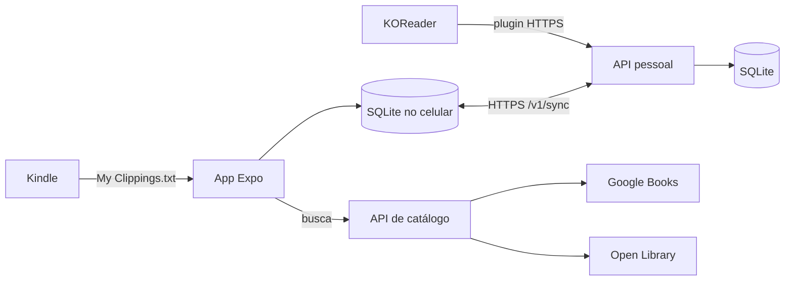

# Diário de leitura

Aplicativo open source para registrar leituras pelo celular, com servidor próprio (self-hosted) e integração com Kindle. O app funciona offline sobre SQLite local; a sincronização, o catálogo de livros e o plugin KOReader são opcionais.

## Funcionalidades

- **Livros e leituras:** cadastro de livros e registro manual de sessões com data/hora, duração, progresso (página, posição ou porcentagem) e nota. Edição, exclusão e histórico com busca.
- **Cronômetro:** inicia, pausa e registra uma sessão; continua contando com o app em segundo plano ou fechado.
- **Sequência e estatísticas:** sequência atual e recorde, conquistas, meta diária de minutos, filtros de 7 dias, 30 dias e todo o histórico, detalhes por livro.
- **Catálogo:** sugestões ao cadastrar e busca de capa, autoria e assuntos via Google Books e Open Library, por meio de uma API central.
- **Sincronização:** com seu próprio servidor, com operações idempotentes, detecção e resolução de conflitos.
- **Backup portátil:** exportação e restauração aditiva em JSON.
- **Kindle:** importação de `My Clippings.txt` (destaques, notas e marcadores) com prévia e deduplicação.
- **KOReader:** plugin que envia tempo de leitura e progresso de um Kindle com KOReader para o servidor.

## Arquitetura



| Pasta | Conteúdo |
| --- | --- |
| `apps/mobile` | App React Native + Expo + TypeScript (Android primeiro) |
| `apps/server` | API pessoal de sincronização (`src/server.js`) e API de catálogo (`src/catalog`), Node 24 com SQLite |
| `integrations/koreader` | Plugin KOReader em Lua, testes e empacotador |
| `scripts` | Inicializador de desenvolvimento (`pnpm dev`) |
| `compose.yaml` | API pessoal em Docker |
| `compose.catalog.yaml` | API de catálogo em Docker |

Cada instalação atende uma pessoa. A API pessoal usa um token bearer (`READING_LOG_TOKEN`) em todas as rotas de dados; não há contas de usuário.

## Requisitos

- Node.js 24.15+
- pnpm 8.6.12 (fixado em `package.json`)
- Docker com Compose (para hospedar as APIs)
- Expo Go no Android, para desenvolvimento

## Desenvolvimento

```sh
pnpm install
pnpm start          # apenas o Expo
```

Escaneie o QR code com o Expo Go, com celular e computador na mesma rede. Os dados ficam no armazenamento local do app.

### Ambiente completo com `pnpm dev`

`pnpm dev` inicia, em ordem, a API pessoal, um túnel ngrok e o Expo, aguardando cada serviço ficar pronto. Serviços compatíveis já ativos são reutilizados, e **Ctrl+C** encerra apenas o que o comando iniciou. `pnpm dev --no-app` inicia só API e túnel (útil com o APK instalado). `pnpm dev --help` lista as opções.

| Serviço | Endereço local |
| --- | --- |
| API pessoal | `http://127.0.0.1:8080` (`API_PORT`) |
| Administração do ngrok | `http://127.0.0.1:4041` |
| Expo/Metro | `http://127.0.0.1:8082` |

Preparação:

- `.env` na raiz (copie de `.env.example`) com `READING_LOG_TOKEN` (32+ caracteres) e `NGROK_AUTHTOKEN`.
- Executável do ngrok em `.local/personal-sync/ngrok/bin/ngrok.exe`.
- Node 24.15+ no PATH ou indicado em `READING_LOG_NODE_PATH`.

O banco de desenvolvimento fica em `data/reading-log.db` e a URL HTTPS do túnel em `.local/personal-sync/endpoint.json` (ambos ignorados pelo Git).

### Variáveis de ambiente

| Variável | Onde | Uso |
| --- | --- | --- |
| `READING_LOG_TOKEN` | `.env` | Token bearer da API pessoal |
| `API_PORT` | `.env` | Porta local da API pessoal (8080) |
| `PUBLIC_DOMAIN` | `.env` | Domínio público servido pelo Caddy (perfil `proxy`) |
| `KOREADER_TIME_ZONE` | `.env` | Fuso das leituras KOReader (padrão `America/Sao_Paulo`) |
| `GOOGLE_BOOKS_API_KEY` | `.env` | Chave do Google Books, **só no servidor de catálogo** |
| `CATALOG_CONTACT_EMAIL` | `.env` | Contato enviado no User-Agent da Open Library |
| `CATALOG_PORT` | `.env` | Porta do catálogo (8081) |
| `EXPO_PUBLIC_CATALOG_API_URL` | `apps/mobile/.env` e EAS | URL HTTPS pública do catálogo |

Nunca coloque a chave Google ou o token em variáveis `EXPO_PUBLIC_`.

### Testes e verificação

```sh
pnpm test
pnpm typecheck
pnpm --filter @reading-log/mobile exec expo export --platform android --output-dir .expo-export-check
```

Os testes rodam com `node --test`, usando SQLite real via `node:sqlite` e o mesmo motor de sincronização do app. Os testes do plugin KOReader usam Python 3 com `lupa` (`integrations/koreader/test/run.py`).

## Servidor self-hosted

1. Copie `.env.example` para `.env` e gere um token aleatório para `READING_LOG_TOKEN`. Em PowerShell:

   ```powershell
   $bytes = [byte[]]::new(32)
   [System.Security.Cryptography.RandomNumberGenerator]::Fill($bytes)
   [Convert]::ToHexString($bytes).ToLowerInvariant()
   ```

2. Execute `docker compose up -d --build`.
3. Confira `http://localhost:8080/health` (`{ "status": "ok" }`).

O Compose publica a API somente em `127.0.0.1` e persiste o banco no volume `reading_log_data`. Para o celular, disponibilize um endereço **HTTPS estável** (por exemplo, um túnel Cloudflare nomeado ou proxy reverso). O app fixa a URL ao salvar a conexão, então URLs temporárias não são adequadas para uso contínuo.

### Publicar na VPS

Para servir a API em um domínio próprio com HTTPS automático (Caddy, TLS 1.2–1.3, certificado renovado sozinho):

1. Crie um registro DNS **A** (e **AAAA** somente se a VPS tiver IPv6 funcional) para o subdomínio, por exemplo `leituras.seudominio.com`.
2. Libere no firewall `80/tcp` e `443/tcp` (e `443/udp` para HTTP/3).
3. Defina `PUBLIC_DOMAIN` no `.env` e execute `docker compose --profile proxy up -d --build`.
4. Verifique:

   ```bash
   curl -sS https://<PUBLIC_DOMAIN>/health
   openssl s_client -connect <PUBLIC_DOMAIN>:443 -tls1_2 -servername <PUBLIC_DOMAIN>
   curl -sS -H "Authorization: Bearer $READING_LOG_TOKEN" https://<PUBLIC_DOMAIN>/v1/server
   ```

   O último retorna `{ "protocolVersion": 1, "serverId": "..." }`.

Ordem de implantação ao sair de um túnel (ngrok) para o domínio:

1. Publique o servidor novo na VPS (o túnel continua apontando para ele).
2. Configure DNS e `PUBLIC_DOMAIN`, suba o Caddy e verifique `/health` e TLS 1.2.
3. Instale o plugin novo no Kindle e a build nova do app (EAS).
4. Em cada aparelho, conecte-se uma vez pelo endereço antigo para memorizar o `serverId`: no Kindle use **Testar conexão** (ou **Sincronizar agora**); no celular, **Sincronizar agora**. No Kindle, **Testar conexão** funciona mesmo com o envio bloqueado (por exemplo, por erro de TLS) e libera esse bloqueio; **Sincronizar agora** não faz nada enquanto o envio estiver bloqueado.
5. Use **Migrar servidor** em cada aparelho para `https://<PUBLIC_DOMAIN>`.
6. Confirme o envio das pendências do Kindle e a sincronização do celular.
7. Desligue o agente do túnel.

### Backup e restauração do servidor

Backup consistente com a API ativa (usa o backup nativo do SQLite e verifica integridade):

```powershell
$backupDir = Join-Path (Get-Location).Path 'backups'
New-Item -ItemType Directory -Force -Path $backupDir | Out-Null
$stamp = Get-Date -Format 'yyyyMMdd-HHmmss'
docker compose run --rm --no-deps -v "${backupDir}:/backups" api node src/maintenance.js backup "/backups/reading-log-$stamp.sqlite"
```

Restauração (com a API parada; o banco anterior é preservado como `reading-log.db.before-restore-...`):

```powershell
docker compose stop api
docker compose run --rm --no-deps -v "${backupDir}:/backups" api node src/maintenance.js restore /backups/reading-log-AAAAMMDD-HHMMSS.sqlite --offline
docker compose up -d api
```

Não use `docker compose down -v`: o `-v` remove o volume. Restaurar um backup antigo pode deixar aparelhos com cursores à frente do servidor; o app pausa a sincronização nesse caso em vez de descartar dados.

## Sincronização

No app, abra **Configurações → Sincronização**, informe URL e token, teste e salve. O token fica no SecureStore do Android, separado do SQLite.

- O SQLite local é a fonte da interface. Cada alteração grava o registro e a pendência na mesma transação.
- Sincroniza ao abrir/retomar, após salvar ou excluir e pelo botão **Sincronizar agora**. Não há execução em segundo plano.
- Falhas temporárias repetem com atraso progressivo de até 30 s; token inválido interrompe até a correção.
- Conflitos ficam persistidos e pedem uma escolha: **Manter minha versão** ou **Usar versão do servidor**.
- Exclusões são lógicas (tombstones) e também são propagadas: sincronização não substitui backup.
- Para trocar o endereço do servidor use **Migrar servidor**: no app, **Configurações → Sincronização → Conexão → Migrar servidor**; no Kindle, menu **Books Project → Migrar servidor**. Antes, o aparelho precisa ter se conectado com sucesso ao menos uma vez pelo endereço atual (isso memoriza o identificador do servidor): no Kindle use **Testar conexão** (ou **Sincronizar agora**), que funciona mesmo com o envio bloqueado por TLS; no app, **Sincronizar agora**. O novo endereço só é aceito se levar ao mesmo servidor (`GET /v1/server`); caso contrário nada é alterado. A migração preserva fila, pendências, conflitos e token.

### Protocolo

`POST /v1/sync` com `Authorization: Bearer <token>` e corpo `{ cursor, operations }`, até 100 operações por lote. Cada operação tem `opId`, `entity` (`book`, `log` ou `annotation`), `id`, `baseVersion`, `deleted` e `data`. A resposta é `{ results, changes, cursor, hasMore }`, com páginas de até 500 mudanças. Reenviar a mesma operação é idempotente; conflitos retornam a versão atual. O protocolo ainda não é estável para clientes externos.

## Backup portátil (app)

Em **Configurações → Backup e restauração**:

- **Exportar backup** gera `leituras-backup-<data>.json` (livros, leituras, anotações Kindle e vínculos de catálogo) e abre o compartilhamento do Android. Token, URL, fila de sincronização, meta diária e cronômetro não são incluídos. O arquivo não é criptografado.
- **Selecionar backup** mostra uma prévia e restaura de forma **aditiva**: adiciona apenas registros ausentes, mantendo IDs, e nunca substitui dados existentes.

Formato `reading-log-backup` versão 4 (lê também as versões 1 a 3), até 25 MB e 50.000 registros. O backup integral do servidor (acima) é complementar: preserva versões, operações e cursor.

## Catálogo de livros

A API de catálogo é um processo separado, sem banco de dados e sem acesso ao token pessoal. O app envia apenas título, autor, fonte e idioma.

- Ao **Adicionar livro**, após 3 caracteres e 600 ms sem digitar, o app consulta o Google Books e, se não houver resultado ou o fornecedor falhar, a Open Library. A primeira edição fica sugerida; é possível escolher outra ou **Cadastrar manualmente**.
- Nos detalhes do livro, **Buscar informações** permite escolher a fonte e o idioma (**Português** ou **Todos os idiomas**).
- Capas da Open Library são salvas para uso offline. Do Google Books, só o ID do volume é guardado; capa e categorias são consultadas online.

### Hospedar o catálogo

1. No Google Cloud, ative a Books API e crie uma chave de servidor restrita a ela, com cota e alertas.
2. Configure `GOOGLE_BOOKS_API_KEY` e `CATALOG_CONTACT_EMAIL` no `.env` e rode:

   ```sh
   docker compose -f compose.catalog.yaml up --build -d
   curl http://127.0.0.1:8081/health
   ```

   Sem Docker: `node --env-file=.env apps/server/src/catalog/main.js` (defina `PORT` para não conflitar com a API pessoal).

3. Publique em HTTPS por um proxy reverso com limite de requisições por IP. Exemplo Nginx:

   ```nginx
   limit_req_zone $binary_remote_addr zone=catalog_client:10m rate=30r/m;

   server {
       listen 443 ssl;
       server_name catalogo.seudominio.com;
       ssl_certificate /etc/letsencrypt/live/catalogo.seudominio.com/fullchain.pem;
       ssl_certificate_key /etc/letsencrypt/live/catalogo.seudominio.com/privkey.pem;
       error_log /dev/null;
       limit_req zone=catalog_client burst=5 nodelay;
       limit_req_status 429;
       location / {
           proxy_pass http://127.0.0.1:8081;
           proxy_set_header Host $host;
           proxy_set_header Authorization "";
           proxy_set_header Cookie "";
           proxy_set_header X-Forwarded-For "";
           proxy_read_timeout 15s;
       }
   }
   ```

4. Defina `EXPO_PUBLIC_CATALOG_API_URL=https://catalogo.seudominio.com` em `apps/mobile/.env` e nos ambientes **preview/production** do EAS. Uma URL nova exige nova build.

O gateway limita a saída (Google 10 req/s, Open Library 3 req/s), usa timeout de 8 s e não registra termos de busca. Rotas: `GET /health`, `GET /v1/catalog/search?source=google|openlibrary&title=...&author=...&language=pt|all` e `GET /v1/catalog/google/volumes/{id}`. A atribuição "Powered by Google" segue as diretrizes de marca do Google Books.

## Anotações Kindle

Em **Configurações → Anotações Kindle**, selecione uma cópia do `My Clippings.txt`. O app lê o arquivo localmente, mostra a prévia e pede para associar cada título a um livro existente, a um livro novo ou ignorá-lo.

- Formatos em português e inglês, UTF-8 com ou sem BOM, até 10 MB e 10.000 blocos.
- Deduplicação por fingerprint SHA-256 (título, autor, tipo, local e conteúdo); trechos excluídos não voltam em reimportações.
- Anotações não criam sessões nem contam para a sequência. São sincronizadas e entram no backup.
- O app não acessa a conta Amazon.

## KOReader

O plugin `integrations/koreader/booksproject.koplugin` envia tempo e progresso das estatísticas nativas do KOReader para a API pessoal. Alvo de desenvolvimento: KOReader 2026.07.1.

**Gerar o pacote:** `node integrations/koreader/package.mjs` (requer Python 3) gera `.local/koreader-adapter/booksproject.koplugin.zip`, sem credenciais.

**Instalar:**

1. Com o KOReader fechado, faça backup da pasta de configurações e de `statistics.sqlite3`.
2. Conecte o Kindle por USB e extraia o ZIP em `koreader/plugins/`, formando `plugins/booksproject.koplugin/main.lua`.
3. No KOReader, menu **Books Project**: configure **Servidor HTTPS** e **Token pessoal** (os mesmos do app). O token fica em `booksproject.lua`; não compartilhe esse arquivo.
4. Ative as estatísticas nativas, conecte o Wi-Fi e use **Testar conexão**. É exigido HTTPS com certificado válido e nome DNS.

**Funcionamento:**

- A coleta começa automaticamente após a configuração e envia leituras posteriores à ativação: a cada cinco minutos, ao fechar o livro, ao suspender (**Sincronizar ao suspender**) e ao retomar.
- Pendências ficam numa fila SQLite no Kindle e são reenviadas de forma idempotente. Não há envio em segundo plano com o aparelho dormindo.
- O servidor gera uma leitura por dia, documento e aparelho, no fuso `KOREADER_TIME_ZONE`. Associa pelo título normalizado (e autor, em caso de empate) ou cria um livro novo, que o app enriquece pelo catálogo.
- Associações ambíguas ficam pendentes em **Configurações → KOReader** no app.
- Leituras KOReader não podem ser editadas no app, apenas excluídas.
- Os menus **Estado**, **Diagnóstico** e **Problemas** mostram fila, último envio e erros (sem expor token ou URL).

Rotas autenticadas: `/v1/koreader/status`, `/documents`, `/ingest` e `/documents/:id/link`. As leituras chegam ao app pelo `/v1/sync`.

## Build Android (APK)

O perfil `preview` de `apps/mobile/eas.json` gera um APK de distribuição interna:

```sh
cd apps/mobile
pnpm dlx eas-cli@latest login
pnpm dlx eas-cli@latest build --platform android --profile preview
```

A URL do catálogo não fica no repositório: o perfil usa o ambiente `preview` do EAS, onde `EXPO_PUBLIC_CATALOG_API_URL` é definida uma vez:

```sh
pnpm dlx eas-cli@latest env:create preview --name EXPO_PUBLIC_CATALOG_API_URL --value https://catalogo.seudominio.com --visibility plaintext
```

Atualizações precisam manter o mesmo pacote e chave de assinatura e aumentar `android.versionCode`. O identificador `dev.readinglog.app` é provisório. Os ícones ficam em `apps/mobile/assets/` (gerados por `generate_icons.py`).

O Expo Go e o APK guardam dados em áreas separadas: para migrar, exporte um backup no Expo Go e restaure no APK.

## Status

Os fluxos de app, sincronização, backup, cronômetro, catálogo, importação Kindle e plugin KOReader estão implementados e cobertos por testes automatizados. Validação extensiva em aparelho Android e Kindle ainda está em andamento. iOS e contas de múltiplos usuários estão fora do escopo atual.

## Segurança e privacidade

- Nenhum segredo fica no repositório. Token, chaves e URLs reais ficam em arquivos `.env` (ignorados pelo Git) ou nas variáveis de ambiente do EAS; os arquivos `.env.example` trazem apenas os nomes.
- O token pessoal fica no SecureStore do Android e, no Kindle, em `booksproject.lua`. Nenhum dos dois entra em backups, logs ou telas de diagnóstico.
- A chave do Google Books existe somente no servidor de catálogo, que não tem acesso ao token pessoal nem guarda termos de busca.
- Bancos SQLite, backups, APKs e artefatos locais (`data/`, `backups/`, `.local/`, `*.db`, `*.apk`) são ignorados pelo Git.
- Exponha a API apenas por HTTPS com certificado válido. O Compose publica as portas só em `127.0.0.1`; o acesso externo passa pelo Caddy.

## Licença

A definir.
